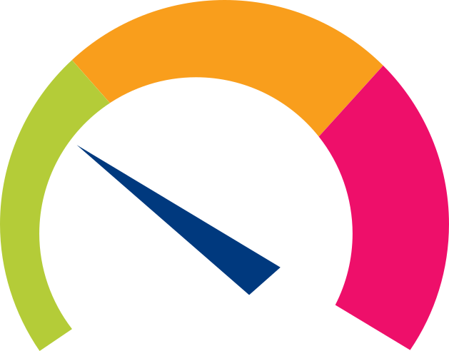
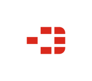
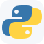
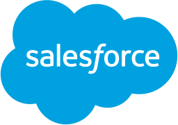

# VoiceCast integrations

Connect VoiceCast to monitoring platforms, automation tools and CRM systems to
turn alerts, workflow events and customer updates into telephone calls. Each
integration queues calls through the VoiceCast Calls v2 API and includes its own
installation and configuration guide.

A successful API response means the call was queued. VoiceCast's dispatcher
places the call asynchronously and records the final status and callflow events.

## Before installing

You need a VoiceCast tenant URL, API key and callflow UUID. You can get these from CloudAware by requesting Voicecast access from voicecast@cloudaware.eu

## Monitoring and alerting

| Logo | Integration | What it does |
| :---: | --- | --- |
|  | [Zabbix](zabbix/) | Turn Zabbix problems, recoveries and escalation messages into voice calls. |
|  | [Icinga 2](icinga/) | Send host and service notifications through a VoiceCast callflow. |
|  | [PRTG Network Monitor](prtg/) | Run a PowerShell notification client when PRTG raises an alarm. |
|  | [Grafana Alerting](grafana/) | Use a webhook contact point to call recipients for Grafana alert groups. |
|  | [LibreNMS](librenms/) | Send device and service alerts through the native API transport. |
|  | [Uptime Kuma](uptime-kuma/) | Call responders from built-in webhook notifications. |
|  | [Checkmk](checkmk/) | Run a site-local notification script for host and service state changes. |
|  | [MikroTik RouterOS](mikrotik/) | Queue spoken alerts directly from Netwatch, the scheduler or another on-router script. |
|  | [FortiGate](fortigate/) | Turn FortiGate security, SD-WAN and system events into spoken telephone alerts. |

## Automation and orchestration

| Logo | Integration | What it does |
| :---: | --- | --- |
|  | [curl](curl/) | Place immediate or scheduled calls from a terminal or shell script. |
|  | [Home Assistant](home-assistant/) | Trigger reusable VoiceCast call actions from automations and dashboards. |
|  | [monday.com](monday/) | Add a VoiceCast call action to monday workflows. |
|  | [n8n](n8n/) | Import a reusable workflow for calls from other n8n workflows. |
|  | [Node-RED](node-red/) | Add a VoiceCast call node to event-driven flows. |
|  | [Apache Airflow](apache-airflow/) | Queue templated calls from DAGs and return the call UUID through XCom. |
|  | [Zapier](zapier/) | Add a Place VoiceCast Call action to Zaps. |
|  | [Make](make/) | Add a VoiceCast action module to Make scenarios. |
|  | [Windmill](windmill/) | Place calls from scripts, schedules, webhooks, Flows and Apps. |

## Developer libraries

| Logo | Integration | What it does |
| :---: | --- | --- |
|  | [PHP](php/) | Add immediate and scheduled calls to PHP applications with a reusable client class. |
|  | [Python](python/) | Add immediate and scheduled calls to Python applications with a standard-library client class. |
|  | [Model Context Protocol](mcp/) | Connect MCP clients to tenant-scoped callflow and call tools over STDIO or authenticated HTTP. |

## CRM and customer workflows

| Logo | Integration | What it does |
| :---: | --- | --- |
|  | [HubSpot](hubspot/) | Queue calls from contact, company, deal and ticket workflows. |
|  | [Salesforce](salesforce/) | Deploy an invocable Apex action for Salesforce Flow. |
|  | [SugarCRM](sugarcrm/) | Trigger calls when configured Case or Lead fields change. |
|  | [SuiteCRM](suitecrm/) | Trigger calls from SuiteCRM Case and Lead state changes. |
